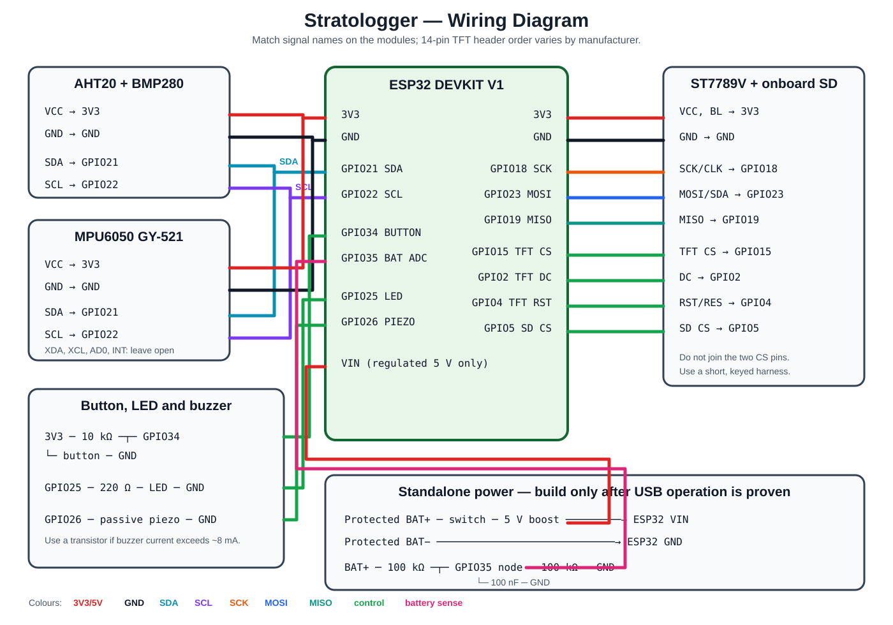

# High-altitude telemetry payload

This repository documents an ongoing ESP32 telemetry payload that records
environmental and inertial measurements, stores them on a microSD card, and presents
live mission data on a 320 by 240 display. The project is divided into electrical,
display, mechanical, and software subsystems so that each part can be assembled and
validated independently.

**Author:** Trishan Biswas  
**Project started:** February 2026  
**Status:** Ongoing prototype development



## Contents

[Overview](#overview) | [Current state](#current-state) | [Hardware](#hardware) |
[Firmware](#firmware) | [Data format](#data-format) | [Mechanical design](#mechanical-design) |
[Repository guide](#repository-guide) | [Build](#build) | [Validation](#validation) |
[Limits](#limits) | [Next work](#next-work) | [Licence](#licence)

## Overview

The payload uses an ESP32 DevKit V1 as the controller. An AHT20/BMP280 combination
board measures temperature, humidity, pressure, and barometric altitude. An MPU6050
records three-axis acceleration and angular velocity. The ST7789V display and its
onboard microSD socket share one VSPI bus with separate chip-select lines.

| Subsystem | Main components | Purpose |
|---|---|---|
| Electrical | ESP32, sensors, indicators, regulated supply | Power distribution and signal interconnection |
| Display | ST7789V TFT and onboard SD socket | Live telemetry and data storage |
| Mechanical | Parametric PETG enclosure | Module retention, access, ventilation, and protection |
| Software | Arduino framework and PlatformIO | Acquisition, logging, display rendering, and fault reporting |

The firmware records one packet every 500 ms. Each packet contains environmental
measurements, barometric altitude, acceleration, angular velocity, a timestamp, a
packet number, and a 32-bit XOR integrity value.

## Current state

| Area | State at 18 October 2026 |
|---|---|
| Firmware | Builds successfully for `esp32dev` with the pinned PlatformIO configuration |
| Host validation | CSV integrity tests pass |
| Electrical design | Pin map, BOM, netlist, wiring diagram, and assembly guidance documented |
| Breadboard assembly | Physical validation evidence not yet published |
| Perfboard assembly | Pending breadboard validation |
| Enclosure | Parametric source complete; final dimensions and printed fit remain unverified |
| Mission data | No hardware capture is currently published |

Software completion does not establish hardware operation. Photographs, measurements,
and data will be added only after the corresponding configuration has been tested.

## Hardware

### Pin assignment

| Function | ESP32 pin |
|---|---:|
| I2C SDA / SCL | GPIO21 / GPIO22 |
| VSPI SCK / MOSI / MISO | GPIO18 / GPIO23 / GPIO19 |
| TFT CS / DC / RST | GPIO15 / GPIO2 / GPIO4 |
| SD CS | GPIO5 |
| Status LED / passive piezo | GPIO25 / GPIO26 |
| Screen button | GPIO34 with external 10 kOhm pull-up |
| Battery measurement | GPIO35 through a 100 kOhm / 100 kOhm divider |

GPIO34 has no internal pull-up. The button therefore requires the documented external
resistor. GPIO35 was selected as the battery ADC input because it is input-only and
does not conflict with the other buses.

The exact wiring is recorded in the [diagram](electrical/wiring-diagram.svg),
[netlist](electrical/netlist.csv), and [assembly guide](electrical/assembly.md).
Fourteen-pin ST7789 boards do not have a universal header order; connections must be
matched to the silk-screened signal names on the actual module.

> [!CAUTION]
> A bare 3.0 to 4.2 V Li-ion or LiPo cell must not be connected directly to the
> DevKit `VIN` pin. Standalone operation requires a protected cell and a verified
> regulated supply. Initial bring-up should use USB power.

## Firmware

The runtime is divided into four modules:

- `SensorManager` reads the three I2C devices and derives load, roll, and pitch.
- `TelemetryLogger` creates non-overwriting CSV files and flushes each packet to SD.
- `DisplayManager` maintains graph buffers and renders three mission-control screens.
- `StatusIndicators` controls the boot tones, fault codes, and packet heartbeat.

The TFT and SD socket are accessed sequentially because they share VSPI. This avoids
concurrent ownership of the bus and does not require a mutex at the 2 Hz update rate.

At a healthy boot, the payload gives three ascending tones. A fault gives five low
tones followed by a repeating LED code:

| Flashes | Fault |
|---:|---|
| 1 | BMP280 |
| 2 | AHT20 |
| 3 | MPU6050 |
| 4 | SD card |
| 5 | Display frame buffer |

## Data format

Logs are named `/LOG_001.CSV` through `/LOG_999.CSV` without overwriting an existing
file. The schema is:

```text
PACKET_ID,TIMESTAMP_MS,TEMP_C,HUMIDITY_PCT,PRESSURE_HPA,ALTITUDE_M,
ACCEL_X_MS2,ACCEL_Y_MS2,ACCEL_Z_MS2,GYRO_X_RADS,GYRO_Y_RADS,
GYRO_Z_RADS,CHECKSUM_HEX
```

[`data/format-example.csv`](data/format-example.csv) is a short synthetic format
example, not a hardware capture. New runs should be accompanied by the metadata in
[`data/run-metadata-template.yaml`](data/run-metadata-template.yaml).

## Mechanical design

[`mechanical/enclosure.scad`](mechanical/enclosure.scad) generates a base and lid for
PETG printing. The model includes a display aperture, button opening, buzzer vents,
environmental-sensor vents, perfboard supports, and side access for USB and power.

The current dimensions are nominal. The display aperture, mounting holes, perfboard,
connector positions, battery holder, and installed component height must be measured
before the model is treated as print-ready. See the [mechanical notes](mechanical/README.md).

## Repository guide

| Location | Contents |
|---|---|
| [`data/`](data/README.md) | CSV schema example and run metadata template |
| [`docs/`](docs/architecture.md) | Architecture, development record, validation, safety, limits, and test plan |
| [`electrical/`](electrical/assembly.md) | BOM, netlist, wiring diagram, and perfboard guidance |
| [`hardware/`](hardware/README.md) | Physical build state and photograph publication rules |
| [`include/`](include/config.h) | Pin assignments, constants, and shared telemetry types |
| [`mechanical/`](mechanical/README.md) | Parametric enclosure source and fit requirements |
| [`results/`](results/README.md) | Published test results when available |
| [`src/`](src/main.cpp) | ESP32 firmware |
| [`tests/`](tests/test_repository.py) | Repository integrity and metadata tests |
| [`tft/`](tft/README.md) | Display subsystem and TFT_eSPI configuration |
| [`tools/`](tools/validate_log.py) | Host-side CSV validator and tests |

## Build

Install the PlatformIO extension for Visual Studio Code, open the repository root,
and run:

```text
pio run
pio run --target upload
pio device monitor
```

The board configuration and library versions are declared in `platformio.ini`.
TFT_eSPI is configured with build flags, so its installed `User_Setup.h` does not
need to be edited.

## Validation

Run the host checks from the repository root:

```text
python -m unittest discover -s tools -p "test_*.py" -v
python -m unittest discover -s tests -v
python tools/validate_log.py data/format-example.csv
```

The latest software verification record is in [`docs/validation.md`](docs/validation.md).
The planned bench, elevator, thermal, vibration, impact, endurance, and corruption
tests are defined in [`docs/test-plan.md`](docs/test-plan.md).

## Limits

The current repository does not contain evidence of a completed breadboard, perfboard,
printed enclosure, battery endurance run, or environmental test campaign. Barometric
altitude depends on reference-pressure calibration. Gravity-derived roll and pitch
are disturbed by linear acceleration. The 2 Hz mission log is not suitable for a
meaningful vibration FFT above 1 Hz.

The checksum detects simple data corruption but is not cryptographic authentication.
The payload is an engineering prototype and is not flight-certified. Further limits
are recorded in [`docs/limitations.md`](docs/limitations.md).

## Next work

1. Record the exact TFT header order and measured module dimensions.
2. Assemble and photograph the USB-powered breadboard configuration.
3. Verify sensor addresses, display operation, SD logging, and fault codes.
4. Publish a short validated hardware CSV with matching run metadata.
5. Transfer the verified circuit to perfboard and repeat the bench checks.
6. Update the enclosure from measured dimensions and complete a physical fit test.
7. Add the protected standalone power subsystem and endurance testing.

## Licence

The firmware, hardware documentation, and mechanical source are released under the
Apache License 2.0 in [`LICENSE`](LICENSE).

