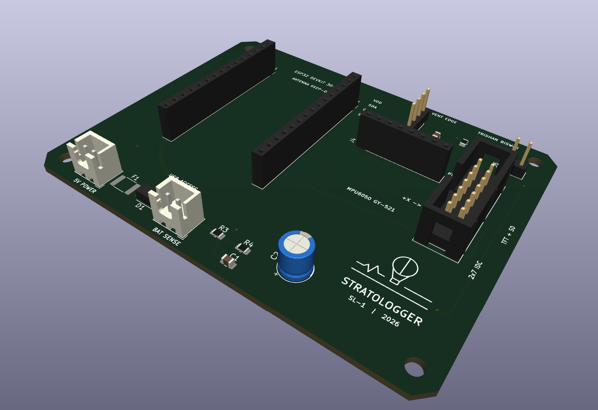
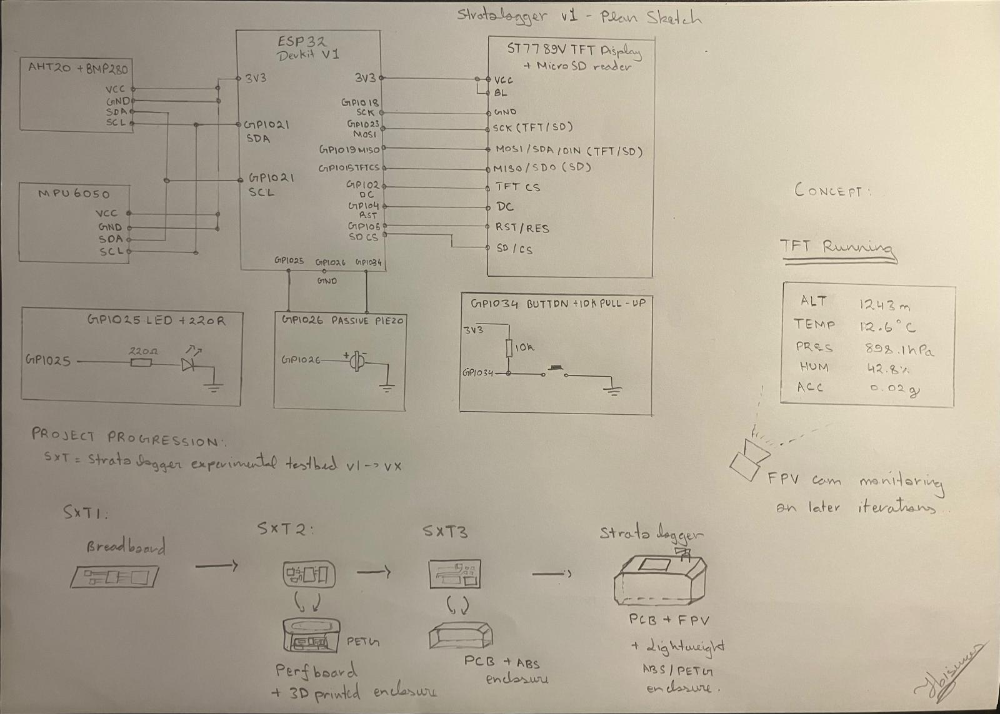
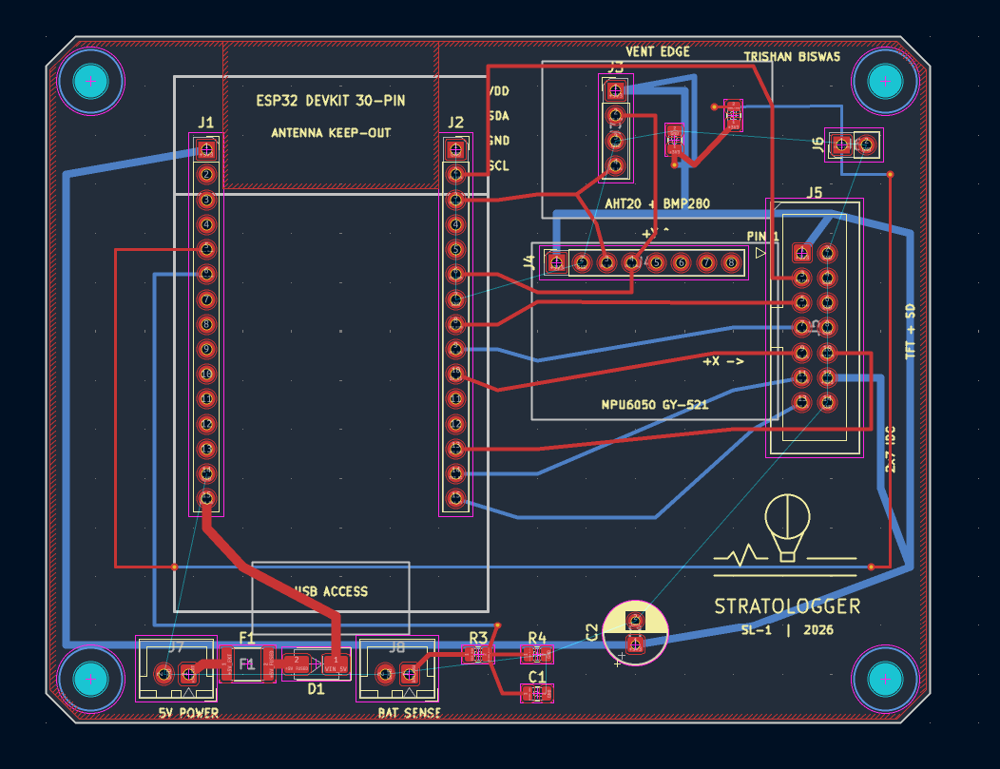
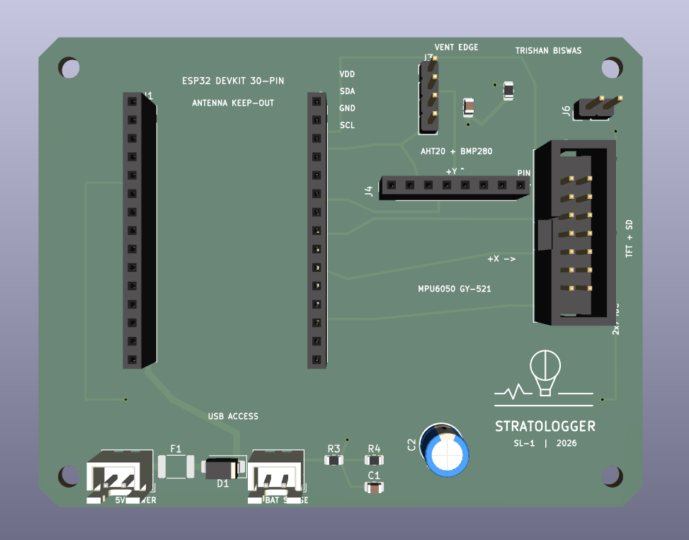
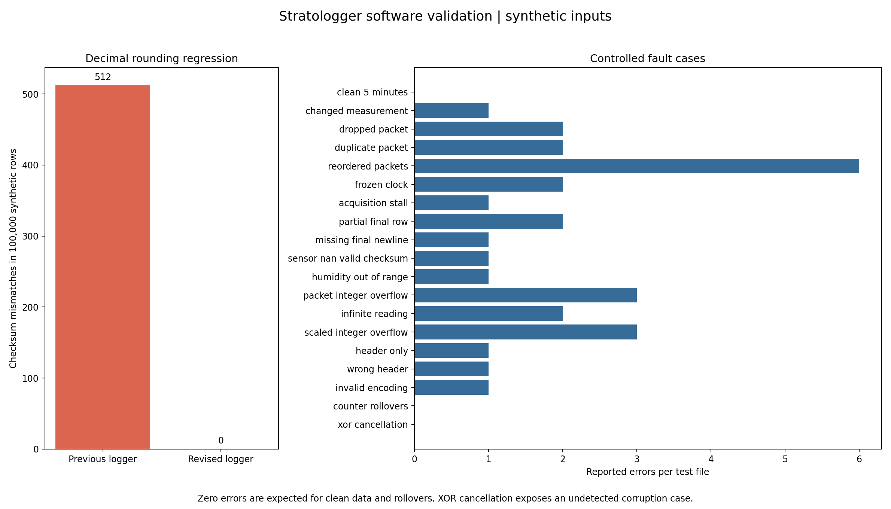

# Stratologger

I'm building an ESP32 payload to record changes in altitude, temperature and motion,
save each run to a microSD card, and show live readings on a small display. The
project combines a custom carrier PCB, removable sensor modules, firmware and a
PETG enclosure. The [contents](#contents) and [repository guide](#repository-guide)
point to the design files, software results and remaining hardware work.

**Author:** Trishan Biswas  
**Project started:** February 2026  
**Status:** Ongoing prototype development

| SL-1 carrier design | Initial system sketch |
|:---:|:---:|
|  |  |
| Current PCB design before manufacture. The ESP32 and sensor modules are not shown. | Original connections and display concept. The custom PCB replaces the drawn breadboard and perfboard stages. |

> [!IMPORTANT]
> **SL-1 is on fabrication hold.** The PCB socket map differs from the common
> 30-pin DOIT ESP32 DevKit V1. Exact module identification, dimensions, pin-map
> correction and rerouting are pending. Do not order the existing Gerber ZIP.
> See [the PCB audit](pcb/SL-1/review/PCB_AUDIT.md).

## Contents

- [SL-1 payload PCB](#sl-1-payload-pcb) · [PCB views](#pcb-views) · [Telemetry validation](#telemetry-validation)
- [Overview](#overview) · [Development](#development) · [Electrical integration](#electrical-integration) · [Display and firmware](#display-and-firmware)
- [Enclosure](#enclosure) · [Data format](#data-format) · [Limitations](#limitations) · [Repository guide](#repository-guide)
- [Next work](#next-work) · [Licence](#licence) · [Building the firmware](#building-the-firmware) · [Reproducing the checks](#reproducing-the-checks)

## SL-1 payload PCB

SL-1 is a two-layer, 90 by 70 mm carrier board. The ESP32 plugs into two 15-pin
female sockets, the AHT20/BMP280 connects through a four-pin male header, and the
GY-521 uses an eight-pin female socket. Four M3 mounting holes support the board
inside the enclosure.

The TFT and its onboard microSD socket mount in the lid and connect through a short
keyed 2x7 harness. Keeping the display separate leaves room for the modules below
and makes it replaceable. The separate TF-card reader is not used.

The [KiCad project](pcb/SL-1/Stratologger_SL1.kicad_pro),
[routed board](pcb/SL-1/Stratologger_SL1.kicad_pcb),
[assembly BOM](pcb/SL-1/manufacturing/assembly-bom.csv) and
[board guide](pcb/SL-1/README.md) are available for review. The design includes
ground planes, an ESP32 antenna keep-out, regulated 5 V input protection and a
single-cell battery-voltage divider.

The audited layout passes KiCad's filled-zone DRC, but the independent pin audit
found that its ESP32 socket assignments do not match the common 30-pin DOIT board.
Passing DRC does not establish the correct module pinout. The existing
[manufacturing outputs](pcb/SL-1/manufacturing/README.md) are historical files;
they will need regenerating after the socket map and routing are corrected.

## PCB views

These are KiCad screenshots of the SL-1 review design before manufacture.
The renders show the carrier, sockets and connectors. The plug-in ESP32, sensor
boards and remote TFT are absent, so these views do not confirm assembled fit.
F1 appears as a footprint because its solid 3D model is not shown.

### Routed layout



### Component renders

| Top view | Angled view |
|:---:|:---:|
|  |  |

## Telemetry validation

I checked the CSV serializer with 100,000 synthetic rows after finding a mismatch
between the checksum calculation and the saved decimal values. The earlier logger
calculated its checksum before rounding the measurements for CSV. That produced
512 checksum mismatches in the test. The revised serializer checks the values
actually written to the file and produced zero mismatches on the same inputs.



All 19 controlled cases met their stated expectations. They cover clean data,
altered measurements, missing and duplicated packets, reordered rows, timing faults,
invalid values, incomplete rows and counter rollover. One case demonstrates that
two changes can cancel under XOR and leave the checksum unchanged.

The [results and method](results/log-validation/README.md) include the
[fault matrix](results/log-validation/fault_matrix.csv), source hashes and limits.
These are software checks with synthetic inputs. Sensor accuracy, SD write
reliability and operation under physical stress still need bench measurements.

## Overview

The payload samples an AHT20/BMP280 combination board and an MPU6050 every 500 ms.
It records temperature, humidity, pressure, barometric altitude, acceleration and
angular velocity, together with packet numbers, timestamps and a checksum.

The work is split into four subsystems:

| Subsystem | Purpose | Current state |
|---|---|---|
| Electrical | Carrier PCB, removable modules and power distribution | SL-1 routed; fabrication held for socket-map correction and measured fit |
| Display | Landscape ST7789V TFT, screen button and onboard SD socket | UI and separate demo compile; physical display and harness checks pending |
| Mechanical | PETG enclosure, module retention, vents and access | Parametric source available; dimensions and printed fit unverified |
| Software | Acquisition, CSV logging, display rendering and host analysis | Firmware builds; synthetic log checks recorded; hardware captures pending |

No assembled payload, battery-endurance result or environmental test run is
currently published.

## Development

The project began in February 2026 with an ESP32, environmental sensing, an IMU,
removable storage and a local display. The first sketch outlined the connections,
screen concept and a path from prototyping to an enclosed payload.

The October firmware baseline brought together sensor acquisition, three display
screens, CSV logging and host validation. The electrical design then moved to the
SL-1 carrier so the modules could remain removable inside the enclosure.

The PCB review exposed the ESP32 socket-map mismatch despite clean routing checks.
The November software checks also exposed the checksum rounding fault described
above. Both findings are recorded in the
[development log](docs/development-log.md) and [validation record](docs/validation.md).

## Electrical integration

| Function | ESP32 pin |
|---|---:|
| I2C SDA / SCL | GPIO21 / GPIO22 |
| VSPI SCK / MOSI / MISO | GPIO18 / GPIO23 / GPIO19 |
| TFT CS / DC / RST | GPIO15 / GPIO2 / GPIO4 |
| SD CS | GPIO5 |
| Screen button | GPIO34 with external 10 kOhm pull-up |
| Battery measurement | GPIO35 through a 100 kOhm / 100 kOhm divider |

These are the intended GPIO functions. The carrier's physical socket positions
still need correcting against the exact ESP32 module. The
[wiring diagram](electrical/wiring-diagram.svg), [netlist](electrical/netlist.csv),
[BOM](electrical/bom.csv) and [assembly guide](electrical/assembly.md) document the
connections and power boundaries.

The environmental header runs `VDD, SDA, GND, SCL`. The display harness must be
matched to the signal names on the actual TFT board; fourteen-pin modules do not
share a universal pin order. TFT and SD use the same SPI bus with separate
chip-select lines.

Standalone power requires a protected single cell and a regulated 5 V supply.
The `5V POWER` input and measurement-only `BAT SENSE` input are separate.
A raw Li-ion or LiPo cell must not be connected directly to the 5 V input.

## Display and firmware

The 2.4-inch ST7789V runs in landscape at 320 by 240 pixels. A single button cycles
between live telemetry, IMU detail and system status. The live view combines an
altitude gauge, a 60-second trace, environmental readings and a simple artificial
horizon. The IMU page shows acceleration and angular-rate traces; the system page
shows raw readings and logging status.

The firmware separates sensor acquisition (`SensorManager`), file handling
(`TelemetryLogger`) and rendering (`DisplayManager`). TFT and SD transfers run
sequentially on the shared SPI bus. Boot faults are reported on the display when
available and through USB serial.

The [display subsystem guide](tft/README.md) includes the cable map and a separate
demo that supplies labelled synthetic values to the UI. Both firmware targets
compile; the display and finished harness still need checking on hardware.

## Enclosure

The [parametric OpenSCAD source](mechanical/enclosure.scad) defines a PETG base and
lid with a display aperture, button opening, sensor vents, PCB supports and USB
access. The carrier mounts in the base and the TFT mounts in the lid.

The dimensions are nominal. Final module heights, TFT mounting holes, battery
holder, cable bends and connector access must be measured before printing. The
[mechanical notes](mechanical/README.md) record the current assumptions.

## Data format

Logs are named `/LOG_001.CSV` through `/LOG_999.CSV` without overwriting an existing
file. Each row follows this schema:

```text
PACKET_ID,TIMESTAMP_MS,TEMP_C,HUMIDITY_PCT,PRESSURE_HPA,ALTITUDE_M,
ACCEL_X_MS2,ACCEL_Y_MS2,ACCEL_Z_MS2,GYRO_X_RADS,GYRO_Y_RADS,
GYRO_Z_RADS,CHECKSUM_HEX
```

The [format example](data/format-example.csv) contains synthetic values. New
hardware captures should include the configuration and conditions recorded in the
[run metadata template](data/run-metadata-template.yaml).

## Limitations

Barometric altitude depends on reference-pressure calibration. Acceleration during
motion distorts the gravity-derived roll and pitch display. The 2 Hz mission log
cannot support a meaningful vibration FFT above 1 Hz; that test needs a separate
acquisition rate.

The XOR checksum misses some combinations of changes. It detects simple corruption
and does not provide authentication. Firmware compilation and host checks also
leave sensor behaviour, supply stability, SD logging and enclosure fit unverified.
The [detailed limits](docs/limitations.md) and [test plan](docs/test-plan.md) cover
the remaining bench, thermal, vibration, impact and endurance work.

## Repository guide

| Location | Contents |
|---|---|
| [`pcb/`](pcb/README.md) | SL-1 KiCad source, review screenshots, audit and manufacturing status |
| [`electrical/`](electrical/assembly.md) | Wiring diagram, netlist, BOM and integration notes |
| [`tft/`](tft/README.md) | Display configuration, screen behaviour and cable map |
| [`mechanical/`](mechanical/README.md) | Parametric enclosure and fit assumptions |
| [`src/`](src/main.cpp) and [`include/`](include/config.h) | ESP32 firmware, display demo and shared configuration |
| [`tools/`](tools/validate_log.py) and [`tests/`](tests/test_repository.py) | CSV analysis, serializer fixture and repository checks |
| [`results/`](results/README.md) | Synthetic telemetry validation and recorded results |
| [`data/`](data/README.md) | CSV example and capture metadata template |
| [`docs/`](docs/development-log.md) | Development, architecture, validation, limits and test plans |
| [`hardware/`](hardware/README.md) | Physical build state and future hardware evidence |

## Next work

1. Confirm the exact ESP32 pinout and measure all module headers and body clearances.
2. Correct the SL-1 socket map and routing, repeat the electrical review and regenerate manufacturing files.
3. Assemble one board and check power, boot, sensors, TFT, SD and the display harness.
4. Fit the enclosure around the measured assembly and standalone power system.
5. Publish repeat captures and physical test results with their build configurations.

## Licence

The firmware, hardware documentation and mechanical source are released under the
Apache License 2.0 in [`LICENSE`](LICENSE).

## Building the firmware

Install the PlatformIO extension for Visual Studio Code and open the repository
root. Build, upload and open the serial monitor with:

```bash
pio run -e esp32dev
pio run -e esp32dev --target upload
pio device monitor
```

The [PlatformIO configuration](platformio.ini) selects the Arduino framework,
dependencies and TFT_eSPI pin settings. The installed library's `User_Setup.h`
does not need editing. To build the display-only demo:

```bash
pio run -e display-demo
```

## Reproducing the checks

Run the host checks from the repository root:

```bash
python -m unittest discover -s tools -p 'test_*.py' -v
python -m unittest discover -s tests -v
python tools/validate_log.py data/format-example.csv
```

The [telemetry validation instructions](results/log-validation/README.md#run-it-again)
explain how to compile the C++ serializer fixture and regenerate the controlled
cases and plots. PCB review and fabrication requirements are documented separately
in the [SL-1 board guide](pcb/SL-1/README.md).
