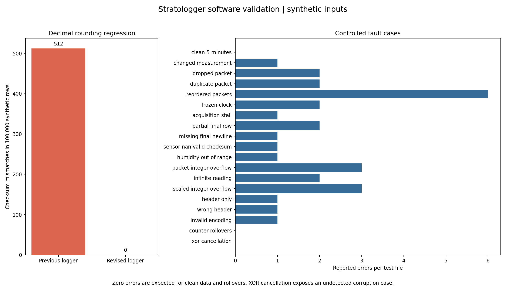

# Telemetry log validation

This is a software test with synthetic input. It is not a sensor run, an SD card test,
or a physical stress test. The plots and [fault matrix](fault_matrix.csv) show what
the host checker reports when a known fault is inserted into a five minute file.

## What changed

The previous logger calculated its XOR checksum from full precision float values,
then saved those values to CSV with two to four decimal places. The validator only
sees the saved numbers. A change at a rounding boundary could therefore make a good
row fail its checksum check. I reproduced the old output format using the same C++
float operations and `snprintf` layout, then compared it with the updated logger.

In 100,000 synthetic rows, the old serializer produced **512 checksum mismatches**.
The revised serializer produced **zero**. It checks the decimal values that are
actually written to the file. This test also checks that the ESP32 firmware builds.
The exact input and source hashes are in [summary.json](summary.json).



## Faults and limits

All 19 cases met their stated expectations. The checker found altered measurements,
missing and duplicated packets, reordered rows, an acquisition delay, a frozen clock,
partial rows, invalid readings and bad headers. It accepted normal 32 bit counter
rollover and a clean five minute stream. A five minute synthetic file tests only the
software format; it does not demonstrate five minutes of physical operation.

The `xor_cancellation` case deliberately changes two measurements by one scaled unit
each. XOR cancels the changes, so the checksum still passes. The plot shows zero
errors for this case. An intact checksum therefore does not prove that every value is
unchanged. Future logging revisions should consider a stronger checksum such as
CRC-32, with a versioned format and a migration plan for old files.

The 750 ms timing limit is a test threshold for the nominal 500 ms sample period. It
is not yet measured jitter on an assembled payload. A clock reset inside one log and
plausible but incorrect sensor values may need independent evidence to diagnose.
Mechanical stress, sensor accuracy, battery behaviour and SD write reliability still
require physical tests.

## Run it again

From the repository root, compile the C++ fixture using a C++11 compiler, then save
both versions of its output. The fixture is in
[`tests/telemetry_csv_fixture.cpp`](../../tests/telemetry_csv_fixture.cpp).
For example, on a Unix shell:

```sh
g++ -std=c++11 -Wall -Wextra -Werror -Iinclude tests/telemetry_csv_fixture.cpp -o telemetry_csv_fixture
./telemetry_csv_fixture 100000 > current.csv
./telemetry_csv_fixture 100000 legacy > legacy.csv
python tools/run_log_campaign.py --current current.csv --legacy legacy.csv
python -m unittest discover -s tools -p 'test_*.py' -v
```

The generated CSV files are deliberately not committed. The script records hashes,
case results, graphs, and the validator runtime in this folder. Review changes to
these files before committing a new result.
